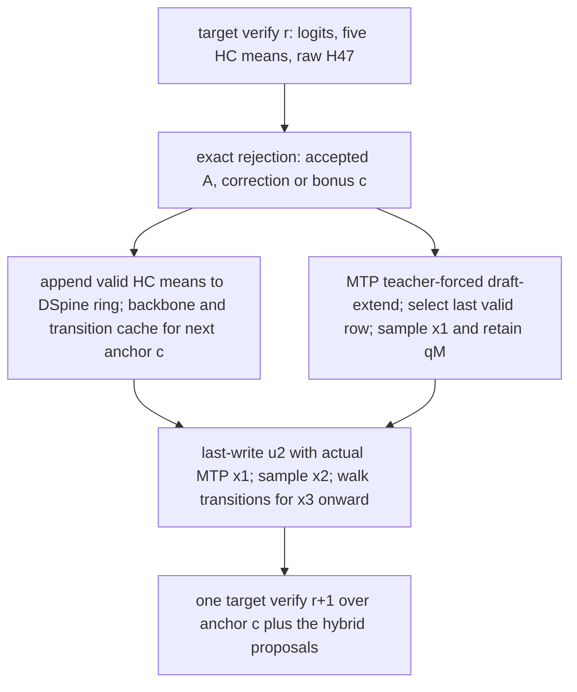

# MTP-first / DSpine-tail serving design

2026-10-17, SERVING. **Design and CPU evidence only.** No GPU reservation, model
server launch, production edit, or change to the existing DSpine worker. Scope is
the pinned SGLang 0.5.21 production image, its private qwenfast overlays, and the
separate `serving/vendor-production` source bundle on the workstation.

## Decision

The hybrid is a valid exact speculative proposal. Use native MTP for proposal 1;
last-write its actual sampled token into DSpine position 2, then walk DSpine's
remaining transition tables. The two models need not agree, share a vocabulary
restriction, or have been trained together. Their *actual conditional proposal
probabilities* must accompany the tokens into rejection sampling.

It is not currently a demonstrated speed win. The CPU replay below reproduces
the C5543 audit, including its weak continuation. With a synthetic first proposal
having 0.76 overlap, fixed-anchor tau rises from 1.84 to about 2.30 at 8 total verify
rows. Historical strong MTP has pooled tau 2.784 at 4 rows. To beat that baseline
by 1.25x, an 8-row hybrid needs roughly 0.86–0.89 conditional acceptance throughout
its DSpine tail; 1.5x needs 0.94–0.97 under optimistic/current planning costs.
The corrected training run may change this conclusion; its suffix has not been
measured here.

Recommend a small offline evaluation/capture first, then a synchronous hybrid
prototype if the continuation gate passes. Preserve native MTP as the deployment
baseline. Train at 16, and initially compare **6 or 8 total verify rows** at bs1.

## 1. Token and row convention

Use `n` for total target verify rows, including the known anchor. Let
`gamma=n-1` be the number of proposals. The current `serving/` flag `--block`
and SPEC's serving `b` mean `n`, not `gamma`.

| Configuration | Known anchor | MTP proposals | DSpine proposals | Verify rows |
|:---|---:|---:|---:|---:|
| Native production NEXTN |1|3|0|4|
| Hybrid n6 |1|1|4|6|
| Hybrid n8 |1|1|6|8|
| Literal six proposals in the request |1|1|5|7|
| Literal eight proposals in the request |1|1|7|9|

If “positions 1..b, verified in b+1 rows” is intended literally, b8 crosses the
existing 8-total-row kernel cap. Measured target cost jumps from 10.096 ms at n8
to 13.835 ms at n9. This design does not append an extra proposal to an existing
n8 block. It **replaces proposal 1**. At bs2, even n6/n8 means 12/16 target rows,
so the original kernels already fall back; bs2 initially stays at n4.

Let the request's committed target KV contain tokens at absolute positions
`<a`; `x0` is the known anchor at `a`, sampled as the previous round's
correction/bonus. This anchor is emitted but not yet in target KV. The block is
`[x0,x1,...,x_gamma]`. Target row 0 predicts x1; row gamma predicts the bonus.

## 2. Exact proposal and verification

Compute the ordinary DSpine block once, from its existing context ring and x0.
Keep its pre-injection final-layer states `u_t`, fixed top 16 candidate sets
`V_t`, and transition tables. Do not feed an MTP token into this backbone pass.

The hybrid proposal is

```
q(x1,...,x_gamma | prefix,x0)
  = q_M(x1 | prefix,x0)
    * q_D,2(x2 | x1; u2,V2)
    * product[t=3..gamma] q_D,t(xt | x[t-1]; u_t,V_t).

q_D,2(v | s) = softmax_{v in V2}(head_rows(V2) @ last_write(u2,s) / T)
q_D,t(v | s) = softmax_{v in V_t}(T_t[index(s),:] / T), t>=3.
```

`last_write` is exactly `dspine/modeling.py:DSpineDraft.last_write`: replace the
predecessor in the final bridge write, starting from the cached **pre-write** u2,
then apply the final norm. Never add a second write to the already-written h2.
Use the same checkpoint proposal-head row reconstruction for candidate selection
and refinement scores, including its saved hot vocabulary and INT8 policy.

An MTP token need not be in DSpine's V1 or hot proposal vocabulary. Its transfer
code `C_s` still exists in the full-vocabulary codebook. Build one new 1x16 row
for V2 from that arbitrary ID. Do not map an absent token to candidate-index 0,
intersect MTP's support with V1, or reuse the old T2 row. For t>=3, the sampled
predecessor belongs to DSpine's previous candidate set, so existing tables apply.

This is final-write conditioning. It does not retroactively inject the MTP
token into earlier backbone layers or make deeper candidates fully autoregressive.
V2 may already omit good successors to an MTP token; exactness survives, acceptance
does not. Re-anchoring the backbone at x1 would serialize it after MTP and require
a different context/position contract, including unavailable target features for
x0. It is not part of this design.

### Why heterogeneous models remain exact

For each reached position i, take the processed target row p_i conditioned on
the accepted prefix. Accept a sampled proposal y~q_i with
`min(1,p_i(y)/q_i(y))`. On the first rejection, sample from
`r_i=(p_i-q_i)+ / sum((p_i-q_i)+)` and discard the suffix. If every proposal is
accepted, sample the bonus from the last target row. The output-token mass is

```
q_i(y) * min(1,p_i(y)/q_i(y)) + (p_i(y)-q_i(y))+ = p_i(y).
```

Apply this identity conditionally at every accepted position. No common-model
assumption appears. q_i can ignore some prefix information and can be zero
outside a sparse support. The MTP and DSpine distributions are normalized
separately; do not multiply a DSpine row by q_M(x1) before passing it to the
chain verifier. At T0, use deterministic proposals and target-argmax prefix
matching with a correction/bonus at the first mismatch, preserving target tie
semantics.

Use fresh proposal/rejection RNG streams, with graph-captured RNG advancement.
Do not choose the first model, block size, candidate support, or acceptance
threshold after inspecting that round's rejection uniforms or target outcomes.
Generation constraints/logit penalties/grammar belong in the target processor
exactly as in the reference target path; any proposal processor is allowed if
the reported q equals the distribution actually sampled.

### Probability layout and the target-law decision

Production `_fast_draft_proposal` with `QWEN_DRAFT_TRUNC=1` produces a full-vocab
q buffer with at most20 nonzero proposal entries for the production top_k20
request. Its hot INT8/screening/truncation arithmetic defines q_M. Record that
row; do not substitute unquantized logits or silently cut it to DSpine's K16.
The remaining q rows have K16 support.

For a first prototype, retain the existing dense chain-verifier staging buffer:
copy native q_M into row 0, scatter the selected DSpine rows into rows 1..gamma-1,
and reuse the exact chain rejection kernel with unit acceptance thresholds.
At n8/bs1 the FP32 staging buffer is about 6.95 MB. Clear every touched row/support
between requests. This is a sparse proposal law with dense staging, as in the
current worker. A later truly sparse kernel can avoid densification. Padding a
rectangular support tensor with duplicate ID0 is unsafe with `scatter_`: a
padding zero can overwrite a real probability. Use masked scatter or the separate
first-row copy. Clone/carry q_M before a graph-pool reuse can overwrite it.

**Pin the processed target law explicitly.** The current DSpine worker uses the
native ordinary sampler's joint top-k/top-p rule. Private production MTP verify
uses sequential top-k then top-p. Equal T1/.95/20 flags do not make these identical
(see `serving/sglang_overlay/sampling.py` and `docs/notes/serving.md`). For a hybrid
claim against production MTP, the primary mode should use **production MTP's
processed target p**, after all target adjustments, and log its identity. A
separate joint-processor mode can compare directly to the existing DSpine tests.
The CPU estimates here use the cached **joint** target law and are not a matched
production-MTP acceptance comparison. Do not alter the frozen oracle-A runtime.

## 3. Data flow, hidden states and cache ownership

Production MTP consumes the final raw4-stream H47 state,10240 dimensions, and
the next token embedding. DSpine consumes the five12800-dimensional HC means,
ending after layer 45. These are separate outputs; H47 cannot be reconstructed
from the current five means. The original production model already exposes H47,
but our project overlay replaces `logits_output.hidden_states` with DSpine means.
A hybrid therefore needs an explicit dual-output capture contract.

Use a project-only packed capture payload `[HC_means_12800; H47_10240]` with
declared width 23040, then split device views before the two consumers. Extend
the target graph runner's output-width/buffer metadata as part of that change;
concatenating into the existing field without updating capture allocation is
insufficient. Keep the target LM-head mixer and its logits untouched. Retain the
current canonical HC means and selected-layer deferred-combine guards. Native
H47 must be fully combined before capture. A dedicated second static output
buffer is an alternative if changing the packed width proves less invasive.

At n8 the extra H47 payload is only 160 KiB/request. During4096-token prefill
chunks it is80 MiB. Consume/release it chunk by chunk: do not retain all 262K
states. DSpine's context K/V stays bounded at W4096.

The steady-state pipeline after verify round r is:



If A proposals accepted, commit **A+1 input states** from verify: the old anchor
and accepted proposals. The new correction/bonus c has no target state yet.
Gather H47 from verify input row A, not from the unverified c or the last padded
row. The existing native draft-extend pairs every valid H47 row with the shifted
next token from `[accepted proposals; c]`, advances MTP's own context KV, and
selects index `request_base + accept_lens - 1`. Its selected row generates q_M
for the next round's first proposal.

This maintenance pass matters. Running just one MTP step from the latest H47
while skipping all intervening committed tokens leaves MTP attention history
incomplete. Reuse native `EagleDraftExtendInput`, shifted IDs, positions,
`num_accept_tokens`, selection and cache conventions; do not add an independent
RoPE increment because the input token is shifted. Invalid padded suffixes must
remain outside the logical committed MTP prefix. MTP KV and DSpine ring are
separate from target KV, GDN/Conv state and QSA pending state. A wrong draft cache
can hurt proposal quality; a wrong target commit or a q row different from its
sampler can break losslessness.

Prefill similarly needs both consumers. Retain native chunked MTP prefill/extend
and final seed generation, while appending only the most recent W target means
to DSpine. No second target or PLE table is loaded. MTP's existing full-context
KV pool, quantized decoder, graph banks and hot head must fit alongside the
DSpine weights/ring/graphs; do not infer resident memory from the 5.21 GB BF16
checkpoint file. Measure the actual production FP8 loader configuration later.

### What can overlap

Once rejection fixes the new committed prefix and c, MTP draft-extend and
DSpine ring append/backbone/cache construction have independent inputs. Launch
them on separate streams with explicit event dependencies and separate graph
buffers/workspaces. The new V2 row and proposal walk join them. MTP usually can
finish before the longer DSpine pass, and its token projections can be prepared
while DSpine computes u2. Do not synchronously copy token IDs to the CPU.

Current `DraftCudaGraphs` captures backbone+cache+ordinary walk together. Split
it into a prepare/cache graph and a hybrid final-write/walk graph, or capture
the joined multi-stream DAG in one owned graph. Replacing x1 after calling
`runtime.propose()` is incorrect: q2 and the subsequent sampled path would still
correspond to the old predecessor. Reuse transition tables only for positions 3+.

After correctness, omit the unused V1 LM-head/top-K scoring and original T2
table in the hybrid prepare graph. Keep backbone position 1: its soft features
still propagate into later positions through attention/injection. No saving
from this smaller head/cache workload is assumed in the cost table.

Overlap is a hypothesis to measure. Both branches read weights/use HBM and SMs;
`max(T_D,T_M)` is an ideal scenario, not a measured critical path or guaranteed
saving. Audit qwenfast/FlashInfer global scratch, QSA index-sharing state, graph
memory-pool aliasing and current-stream behavior before concurrent replay.
Begin synchronously. Preserve target GDN/Conv/PLE/QSA commit and the per-request
slot/rid ownership rules, including preemption, reset and mixed request lengths.

## 4. Latency model

Measured components are from `serving/verify_profile.md` and its committed raw
receipts. At bs1/context 2K:

| Component | Measured ms |
|:---|---:|
| Target n4, isolated sweep |7.701|
| Target n6 |9.108|
| Target n8 |10.096|
| Target n9 |13.835|
| Tuned DSpine n6 proposal compute |1.248|
| Tuned DSpine n8 proposal compute |1.289|
| Native MTP three-proposal draft graph |0.605|
| Native MTP draft-extend/seed, n4 |0.450|
| Native MTP verify 4 in the same clone |7.636|
| Native MTP sum of graph medians |**8.691**|

Source inspection refines the earlier “0.202 ms per MTP step” quotient: the
three-proposal draft graph contains **two** recurrent decoder forwards, because
q1 was already produced by draft-extend; the last loop iteration only selects
the final token. Dividing0.605 by 3 is an amortized per-proposal quotient, not a
standalone MTP-forward timing. The hybrid keeps the append/seed pass and removes
those two recurrent forwards. It must not charge0.202 ms and drop append.

The n6/n8 MTP seed-pass cost has not been measured. As planning budgets use
0.60/0.70 ms; the known n4 costs are0.450 ms at bs1 and 0.560 ms at bs2. Those
different batch/shape results do not measure n8/bs1. There is also a separate
MTP input-fusion fallback: `_fc_int8(fc_hidden, H.reshape(...,4,2560))` returns
BF16 GEMM when flattened rows exceed 16, so n>4 crosses it even below the target's
8-token cap. First benchmark it unchanged. A later project-only bounded-extend
overlay can tile those24/32 stream rows through the existing <=8-row W8 kernels,
leaving long prefill unchanged, but this needs q-fidelity and latency checks.

Let D_n denote DSpine append/backbone/cache, E_n MTP maintenance/seed, J_n the
new last-write/walk join, and H_n all other per-round work:

```
R_hybrid(n) = T_verify(n) + critical_path(D_n, E_n) + J_n + H_n
R_dspine(n) = T_verify(n) + D_n + H'_n
speed = 1000 * tau / R_ms.
```

For the following **planning scenarios**, use measured proposal-only D6/D8,
the assumed E6/E8 above, and a 50 us join budget. DSpine context append, extra
target feature capture, target probability processing/rejection, scheduler and
stream contention remain unmeasured/excluded. Real trained 189,090-ID proposal
heads also differ from the 97.8K-head tuning fixture; 1.3 ms is not an end-to-end
trained-head timing. The 2 ms draft case tests that risk.

| n | Current DSpine core ms | Hybrid ideal-overlap ms | Hybrid serial ms | Hybrid serial with 2 ms draft |
|---:|---:|---:|---:|---:|
|6|10.356|10.406|11.006|11.758|
|8|11.385|11.435|12.135|12.846|

Relative to pure DSpine, full hiding adds only the 50 us join in this model;
serial operation adds about 0.65/0.75 ms. Relative to MTP-only, an n8 hybrid is
about 32–40% more expensive per round before additional overhead, so its tau must
increase by that factor just to break even. At 32K, measured n6/n8 verify rises
only about 0.045/0.052 ms; MTP core rises to 8.748 ms. Full 262K hybrid cost is unmeasured.

Literal b6 proposals means n7: verify 9.587 ms, estimated hybrid 10.907 ms ideal /
11.557 ms serial. Literal b8 proposals means n9: verify 13.835 ms, estimated hybrid
15.327 ms ideal /16.077 ms serial. Its DSpine draft is interpolated, not measured.
The 9-row target cliff dominates the extra proposal's value. See the exact values
and assumptions in `serving/hybrid/cost-plan.json`.

## 5. Expected tau and the required continuation

For actual live rounds let a1=P(first proposal accepted), and let c_i be the
conditional probability that proposal i accepts **given all earlier proposals
accepted**. Then, without an independence assumption,

```
tau_h = 1 + a1 * (1 + c2 + c2*c3 + ... + c2*...*c_gamma).
      = 1 + a1 * C_M.
```

With a1=.76 and a constant conditional tail c, this becomes
`1+.76*sum[j=0..n-2] c^j`. C_M is continuation *conditioned on MTP acceptance*,
not unweighted DSpine continuation. A stronger first proposal can expose harder
tail cases. Do not substitute marginal backbone overlaps for these conditionals.

### Existing scores and new CPU replay

Completed score JSONs on the workstation give:

| Checkpoint | Fixed-anchor proposal 1 overlap | Complete-round T1 tau n6 / n8 |
|:---|---:|:---|
| C-lr3-5543 |.4421|1.6775 /1.6835|
| r3-parent-7122 |.4727|1.7309 /1.7517|
| r3-control-7422 |.4787|1.7609 /1.7695|

Copies are in `serving/hybrid/inputs/`. The r3 no-aux JSONs are OOM/incomplete and
are not evidence. These completed score files report backbone overlap at
positions 2/3, **not conditional hybrid acceptances**. Nor can one divide a
complete-round tau by a first-overlap measured at differently weighted fixed
anchors. Current corrected-run tail quality is still unknown.

I ran `serving/hybrid/cached_ratios.py` on the Mac in CPU FP32, using already
cached C5543 weights, production-effective W8 frozen target tables, its saved
row-INT8, 189,090-ID proposal policy, and 64 held-out T1 target paths. No target
forward, GPU, or new feature transfer was used. Runtime 224s;3578 anchors at
eligible fixed offsets 0..56. The n8 results reproduce Opus's prior 16-row-prefix
calculation within 2e-8. Receipt and raw numerical ratios are committed under
`serving/hybrid/`; source/weight/output hashes are recorded.

For each cached target path Y~p, the exact acceptance estimator uses
`r_i=min(1,q_i(Y_i)/p_i(Y_i))`. These **q/p retention ratios** are the
target-path identity, not the live sampler's p/q acceptance test. Products of
them estimate accepted-prefix survival. Position 2 always receives actual Y1,
including the 33.76% of sampled target Y1 tokens outside DSpine V1. This is a
target-path fraction, not a measured MTP proposal frequency.

| Fixed-anchor diagnostic | n6 | n8 |
|:---|---:|---:|
| DSpine RB tau |1.8220|1.8403|
| Unweighted continuation E[C] after replacing first ratio by 1 |1.6231|1.6470|
| Hybrid sensitivity: independent first retention .76 |2.2335|2.2517|
| Hybrid sensitivity: reuse DSpine correlation rho |2.4131|2.4445|
| Target-informed mixture surrogate, first overlap .76 |2.2770|2.2985|
| Oracle-first q1=p, empirical fixed-anchor ceiling |2.6231|2.6470|

The independent/reused-rho rows are sensitivities, not measured MTP or rigorous
lower/upper bounds. At n8 rho=1.154; actual MTP could correlate differently.
The oracle-first row bounds empirical fixed-anchor tau for this fixed backbone
and tail, because every r1<=1. It is not a bound for the new checkpoint or a
different live round distribution.

The mixture is an explicit normalized synthetic proposal
`q1=lambda*p+(1-lambda)*q_D1`, lambda=.568015 calibrated to mean prefix overlap .76.
Its path retention is `lambda+(1-lambda)*r_D1`. It requires target p before
drafting and is **not deployable MTP**. It preserves one concrete kind of
correlation, unlike replacing every r1 with its mean. Its n8 fixed-anchor95%
prompt-bootstrap interval is[2.2155,2.3847]; n6 is[2.2030,2.3549]. These intervals
describe this surrogate/cohort, not uncertainty about real MTP quality.

The actual conditional survival curves explain the limitation:

| First-proposal policy, n8 | accept1 | c2 | c3 | c4 | c5 | c6 | c7 |
|:---|---:|---:|---:|---:|---:|---:|---:|
| DSpine |.442|.474|.479|.475|.460|.526|.583|
| Target-informed mixture |.759|.390|.447|.463|.457|.498|.538|
| Oracle-first |1.000|.362|.433|.457|.456|.484|.513|

Higher first acceptance does not automatically strengthen position 2. In this
cohort it admits additional cases where DSpine's fixed V2/refinement is weak.
The small surviving sample mass also makes the deepest conditionals less stable.

An additional64-trial walk visits each actual next-round anchor through a fixed
48-token interior window, counting complete rounds that cross the endpoint.
All64 prompts have enough cached suffix; there is no artificial final partial
round. Pooled tau:

| Policy | n6 | n8 |
|:---|---:|---:|
| DSpine |1.6948|1.7019|
| Independent first retention .76 |2.2246|2.2386|
| Target-informed mixture |2.2228|2.2340|
| Oracle-first |2.6033|2.6187|

This is an interior-window diagnostic, not full-request/EOS-aware tau. The mixture
has reached-anchor first retention about .739, showing why fixed-anchor averaging
cannot replace a round walk. MC standard errors are around .001–.003; they do not
cover prompt/generalization or surrogate error. The original full-request score
table remains separate.

### Thresholds against MTP

The historical sampled-request histogram has a1=.76306, conditional accept2
=.76078, accept3=.75819 and pooled tau 2.78373. Request-mean tau 2.84725 is a
different weighting. The rounded constant.76 model gives 2.77658, close to the
pooled value. These are an older target revision/cohort than today's250 tok/s
production summary, whose implied tau was about 2.25. Both baselines matter.

For desired speed multiplier s,

```
required_tau_h = s * tau_M * R_h / R_M
required_C_M   = (required_tau_h - 1) / .76.
```

Using historical strong-MTP tau 2.78373 and the current measured MTP core 8.691 ms
is an **unmatched-cohort planning model**, not a measured throughput comparison:

| n | Cost scenario | Hybrid ms | tau needed 1.25x | Constant tail c needed 1.25x | tau needed 1.5x | Constant tail c needed 1.5x |
|---:|:---|---:|---:|---:|---:|:---|
|6|Ideal overlap|10.406|4.166|.909|4.999|Impossible: max tau 4.80|
|6|Serial|11.006|4.406|.945|5.288|Impossible|
|8|Ideal overlap|11.435|4.578|.864|5.494|.943|
|8|Serial|12.135|4.859|.891|5.830|.968|
|8|Serial,2 ms draft|12.846|5.143|.915|6.172|.991|

For n8, C_M must reach 4.708–5.077 for 1.25x, or 5.913–6.355 for 1.5x in the
fast/serial cases. Current C5543 continuation is around 1.65 unweighted, and the
mixture's acceptance-conditioned continuation is only about 1.71. n6 cannot
reach 1.5x in these strong-baseline cost scenarios even with a perfect tail,
because a1=.76 caps tau at 4.80. This is conditional on the stated cost/a1 model.

Against an **observed 250 tok/s** baseline instead, the fast/serial requirements
are lower, but remain well beyond this old checkpoint:

| n | Hybrid ms, overlap / serial | tau for 312.5 tok/s | tail c for 312.5 tok/s | tau for 375 tok/s | tail c for 375 tok/s |
|---:|:---|:---|:---|:---|:---|
|6|10.406 /11.006|3.252 /3.439|.735 /.776|3.902 /4.127|.865 /.902|
|8|11.435 /12.135|3.574 /3.792|.741 /.773|4.288 /4.551|.833 /.861|

Every unmeasured extra 1 ms raises the n8 tau requirement by 0.400 for 400 tok/s.
Thus compare *matched whole rounds*, not only whether hybrid tau exceeds MTP tau.

## 6. Implementation plan and effort

No following production integration is implemented by this design change.

| Stage | Concrete change | Estimate for one engineer |
|:---|:---|:---|
| CPU proposal prototype | Heterogeneous first-row q adapter, arbitrary-ID last-write, path evaluator and finite-vocab proof test |4–6h; evaluator/proof groundwork now supplied|
| Synchronous isolated Flash worker | One target worker, native MTP loader/extend/seed, DSpine sidecar, dual hidden capture, target-processor selection, request/cache lifecycle |8–16h|
| CUDA graphs and overlap | n6/n8 banks, separate workspaces/events, split prepare/join, graph output ownership, seed carry and RNG |6–12h|
| Integration and validation | Prefix 0/all/mixed rejection, prefill, long context, bs2 fallback, state rollback, numerical parity, matched timing and quality |4–8h engineering plus authorized GPU holds|

Budget roughly 3–5 engineer days for a reviewed serving prototype; GPU scheduling,
large-N exactness and full quality/bench completion add wall time.

Use a dedicated `HybridMTPDSpineWorker`, preferably retaining EAGLE/NEXTN's native
MTP loader and draft-extend phase while attaching the bounded `DSpineRuntime`.
Do not instantiate two full workers that each load a target. Keep one scheduler
state packet carrying the new anchor, target length, q_M/sample, MTP KV ownership
and DSpine slot ownership. Native num-steps 1 can represent the seed-only MTP
proposal path, while total verify/draft-extend width remains n; audit all global
spec-mode and graph-width assumptions instead of mutating runtime flags mid-step.
Do not call native recursive `draft()` to generate additional MTP proposals.

Target verification can retain the current linear DFlash input/positions and
GDN commit, with heterogeneous draft-probability staging. If native EAGLE commit
helpers are used instead, choose one authoritative commit path; never run both.
Keep original <=8-row qwenfast dispatch and project QSA n+3 capacity requirements.
New target kernels/adaptive-b are separate gates, not prerequisites for n6/n8 bs1.

Future validation order:

1. CPU toy joint-law enumeration and serial-vs-cache q parity, including MTP IDs
   outside V1/hot proposals, q-only tokens, p-only tokens, T0 and ties.
2. Real dense and Flash synchronous hybrid with random then trained DSpine head;
   verify packed means/H47 outputs against native capture on identical token IDs.
3. Exhaust every accepted prefix 0..gamma, preserve GDN/Conv/QSA/PLE state, compare
   target rows to full forwards, then wrap/rid reuse/preemption at 32K and 262K.
4. Graph vs eager proposal/q parity; actual request RNG advancement; MTP seed/KV
   parity against production; serial vs overlap correctness before timing.
5. Native live PIT and analytic oracle tests with the chosen processed target
   law, followed by full GSM8K thinking-off and the production agent bench.
   Accepted-only/correction-only PIT groups are descriptive, since conditioning
   on those outcomes changes their distribution.
6. Interleave native MTP / DSpine / hybrid in identical isolated production
   containers, four profiles x4096 xhigh/T1/.95/20 at bs1 then bs2. Report tau,
   steps/s, append/seed/join/verify/sampling costs, host and GPU time, actual
   processor identities, and graph banks. No hybrid speed/quality claim precedes
   these gates.

## 7. Offline evaluation now and MTP capture later

The following commands describe the retained internal study tools, which are not bundled in this portable release. The exhaustive toy-law test is included:

```
CUDA_VISIBLE_DEVICES='' python3 serving/hybrid/cached_ratios.py \
  --checkpoint CKPT --target-tables FROZEN_TABLES \
  --features ALREADY_CACHED_T1_SHARDS --output NEW_RATIOS.jsonl --threads 4

python3 serving/hybrid/analyze.py --ratios serving/hybrid/c5543-ratios.jsonl \
  --output serving/hybrid/c5543-analysis.json
python3 -m unittest serving/hybrid/test_exactness.py -v
```

The analyzer can rerun from the committed numerical ratios without model weights
or features. It includes prompt-bootstrap intervals, both block lengths, a
target-informed first-proposal surrogate, complete interior-round walks, and
latency/conditional-acceptance thresholds. The existing trainer's
`eval_rounds` remains unchanged. Future checkpoint scoring can export the same
per-anchor ratios during its existing forwards to avoid repeating head work.

To measure real hybrid tau, cached target p alone is insufficient: it contains
neither MTP q nor H47. Do not evaluate p along newly sampled off-trajectory MTP
paths using cached rows from a different prefix. Instead teacher-force the
**cached on-policy target tokens** and capture MTP's q1 at every eligible anchor:

| Capture field | Reason |
|:---|:---|
| prompt/token-prefix hash, absolute anchor, sequence/domain, token IDs, sample policy | Exact join with target paths; prevents shifted-row joins|
| q_M support global IDs and normalized FP32 probabilities, and q_M(Y1) | Exact proposal retention/overlap; zero for absent Y1|
| selected/proposal processor, hot-map/screen/INT8/FP8 hashes and code/image hashes | q must be the actual runtime proposal, not reconstructed BF16 logits|
| p support/probabilities and source/numerics identity | Align target law and quantify decode-vs-verify numerical differences|
| MTP KV length, row selection and parent hidden-position identity | Validate shifted input/H47 alignment and teacher-forced cache history|

In an authorized isolated container, replay target prefixes, obtain native H47,
and extend MTP history with the true shifted tokens. Capture its processed q_M
at all anchors, not only rounds where MTP happens to accept. A target full-sequence
prefill plus one MTP prefill is a cheap first diagnostic; replay the actual
draft-extend shapes for a runtime-faithful estimate because BF16/kernel shape
changes can affect q. No need to store full H47: capture q online and discard
the extra hidden states. Include the existing 64 T1 eval prompts and deeper
audit-long anchors; do not rely only on the first 64 response tokens.

Then use `r1_M=min(1,q_M(Y1)/p(Y1))`, recompute position 2 from actual Y1, and
reuse the stored-path identity for all suffix positions. Report actual
`E[r1_M*C]`, per-position conditional survival, candidate coverage, domain/depth
breakdowns, prompt-level intervals and complete-round walks. A fixed-anchor
oracle-first result is a useful ceiling diagnostic; it is not evidence that
MTP supplies that token distribution. Only real MTP q capture resolves the
remaining first-step/tail correlation uncertainty.

## Evidence and remaining risks

- `serving/hybrid/c5543-cpu-receipt.json`, `c5543-ratios.jsonl`,
  `c5543-analysis.json`: fresh CPU replay and reproducible summaries.
- `serving/hybrid/cost-plan.json`, `analyze.py`: measured inputs and explicitly
  assumed seed/join/overlap costs, strong-MTP and 250 tok/s baselines.
- `serving/hybrid/input-receipt.json`: hashes of all 64 existing cached feature
  files and both frozen target tables; no new feature transfer.
- `serving/hybrid/source-receipt.json`: hashes of read-only private production
  source and vendor-production modules; private source itself is not committed.
- `docs/audit/depth1-gap.md`, `depth1/hybrid-estimate-c5543.json`:
  architecture/probe evidence and the prior fixed-path decomposition.
- `docs/audit/dflash-ref.md`, `dflash-ref/reference-summary.json`:
  directly reconstructed historical acceptance histograms and cohort caveats.
- `serving/runtime.py`, `sglang_overlay/worker.py`, `sampling.py`,
  `prepare_target_overlay.py`; `dspine/modeling.py`, `eval_offline.py`,
  `eval_rounds.py`; paper Section4.3: proposal, capture and rejection contracts.

The leading risks are continuation quality after a stronger first proposal,
unmeasured MTP append/seed and trained-head cost, HBM contention, shifted H47/KV
alignment, dual hidden graph allocation, target-processor parity and overlap
workspace safety. None is resolved by the mathematical exactness proof alone.
